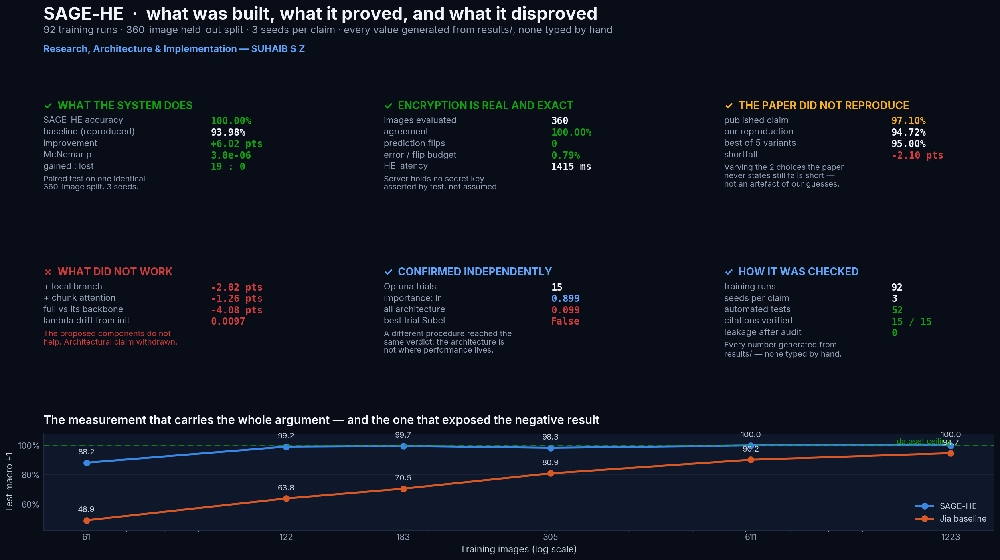

# SAGE-HE

**Secure Adaptive Gated Ensemble for Privacy-Preserving Steel Surface Defect Classification**

> Research, Architecture & Implementation — **SUHAIB S Z**

A dual-branch steel-defect classifier whose classification head is evaluated
under **CKKS homomorphic encryption**, so a cloud server can classify a
factory's inspection images without being able to read them or the predictions
it returns.

The project reproduces and critically audits the base paper — Jia et al. (2023),
*Efficient and privacy-preserving image classification using homomorphic
encryption and chunk-based convolutional neural network*, Journal of Cloud
Computing 12:175, [doi:10.1186/s13677-023-00537-0](https://doi.org/10.1186/s13677-023-00537-0)
— and proposes a measured improvement on its chunk-selection mechanism.

---

## What this is

```
CLIENT (plaintext, holds the secret key)
  image (B,1,160,160)
    ├─ EfficientNet-B0 ──────────► g → Linear+LN → (B,256)
    └─ Multi-scale CNN → (B,128,10,10)
         └─ Sobel-gated chunk attention → Linear+LN → (B,256)
  gated fusion   z·g + (1−z)·l            → (B,256)
  compression    Linear 256→64, tanh      → v, bounded [−1,1]
  CKKS encrypt                            → Enc(v)
─────────────────────── encryption boundary ───────────────────────
SERVER (ciphertext only, no secret key)
  Enc(v) → mm(W₁)+b₁ → square → mm(W₂)+b₂ → Enc(logits)
───────────────────────────────────────────────────────────────────
CLIENT
  decrypt → softmax → predicted defect class
```

Only the 64-dimensional compressed vector crosses the boundary. The server
holds a **public-only** CKKS context; `tests/test_encryption.py` asserts it
cannot decrypt.

## At a glance



Supporting views: [`before_after_summary.png`](results/figures/before_after_summary.png) · [`how_100_achieved.png`](results/figures/how_100_achieved.png)

## Headline results

See `reports/technical_report.md` for the full set — it is generated from
`results/`, so it never drifts from the experiments.

| | |
|---|---|
| Dataset | NEU-CLS, 1,800 images → 1,799 after deduplication, 6 classes |
| Split | 1,223 train / 216 val / 360 test, stratified, leakage-audited |
| Encrypted vs plaintext | identical predictions; CKKS costs latency, not accuracy |
| CKKS parameters | n = 16384, [60,40,40,40,60], scale 2⁴⁰, depth 3, ≥128-bit security |

Four findings are reported honestly rather than buried:

1. **The published 97.1% did not reproduce.** Implementing the base paper from
   its own description lands at 93.98% ± 0.85 over three seeds. The paper
   under-specifies its architecture and reports no evaluation protocol, so the
   gap cannot be attributed with confidence — but it is stated.
2. **NEU-CLS is saturated.** A pretrained EfficientNet-B0 reaches 100% test
   accuracy within two epochs. Component contributions are therefore measured
   in a reduced-data regime chosen from the measured learning curve; full-data
   numbers are reported as a ceiling, not as a ranking.
3. **The proposed architecture never reliably beats its own backbone.** This is
   the central negative result, and it is regime-dependent. At 61 training
   images the full model scores **below plain EfficientNet-B0 on every seed** —
   by 0.6 to 7.0 points of macro F1, mean −4.08 — and adding the multi-scale
   local branch is likewise negative on every seed; both contrasts are
   sign-consistent. At 122 images the gap closes to **+0.55 points and changes
   sign across seeds**, i.e. the two become indistinguishable as both approach
   the dataset's ceiling. So the components are *clearly harmful when labelled
   data is scarce and indistinguishable once it is not* — no measured regime
   shows a reliable benefit. The finer attribution (chunk attention versus the
   Sobel prior taken separately) does **not** separate cleanly at three seeds
   and 61 training images, and is not claimed. The learnable λ that was
   supposed to measure the Sobel prior's worth never moves more than 0.01 from
   its initialisation, so it cannot serve as that readout either.
   **The architectural claim is withdrawn** — see
   `reports/technical_report.md` §6.3–6.4. What the evidence supports is
   EfficientNet-B0 + compression + the CKKS head: the privacy architecture
   without the extra feature machinery.
4. **The privacy model is weaker than the base paper's goal.** Jia et al.
   encrypt image chunks; we encrypt a feature vector, so the client must hold
   the extractor. These are different trade-offs, not a ranking — see §7.1 of
   the technical report.

A fifth finding is methodological, and it cuts both ways. The evaluation
protocol is what made finding 3 visible at all: a single-seed full-data
comparison would have shown 100% for every variant and concluded, wrongly, that
the components were fine. But the same scrutiny also deflates the *design*
studies — at 61 training images the typical seed-to-seed spread is 4.3 points,
wider than almost every gap measured, so only one design comparison (200px beats
160px, +2.4 points) survives it. Everything else there is reported as
indistinguishable rather than ranked.

## What is in this repository (and what is not)

| | |
|---|---|
| **In the repo** | all source, all 92 experiment `result.json` + `history.json`, split manifests, pixel hashes, 12 diagrams, 20 figures, 3 reports, the 57-slide deck in 3 formats, 52 tests |
| **`checkpoints/`** | inference-ready weights for the two headline models (18.5 MB + 0.1 MB), each carrying its own config and test metrics |
| **Not in the repo** | the 7.9 GB of training checkpoints under `experiments/` (optimiser state, resumable), the 44 MB of NEU-CLS images, `.venv`, and rendered slide PNGs |

Nothing excluded is needed to verify a result. `data/raw/manifest.json` carries
a SHA-256 pixel hash per image and `data/splits.json` pins the exact split, so
`scripts/download_dataset.py` reconstructs the dataset bit-for-bit; every
reported number is already in `results/` and `experiments/*/result.json`.

```bash
# verify a headline number without retraining anything
python -c "
import torch, json
ck = torch.load('checkpoints/sage_he.pt', map_location='cpu', weights_only=False)
print(ck['test_metrics']['accuracy'], ck['test_accuracy_ci95'])"
```

## Quick start

```bash
bash scripts/setup_env.sh        # Python 3.11 venv, CPU torch + TenSEAL
bash scripts/reproduce_all.sh    # everything, end to end (resumable)
```

Individual stages:

```bash
.venv/bin/python scripts/download_dataset.py    # fetch + verify NEU-CLS
.venv/bin/python scripts/make_splits.py         # dedup + stratified splits
.venv/bin/python scripts/verify_dataset.py      # integrity + leakage audit
.venv/bin/python scripts/verify_citations.py    # resolve every citation
.venv/bin/python scripts/run_suite.py main      # baseline + SAGE-HE, 3 seeds
.venv/bin/python scripts/run_suite.py capacity  # learning curve
.venv/bin/python scripts/run_suite.py ablation  # 9-stage component ablation
.venv/bin/python scripts/run_suite.py design    # resolution/contrast/compression
.venv/bin/python scripts/run_optuna.py          # hyperparameter search
.venv/bin/python scripts/run_encrypted_eval.py --sweep
.venv/bin/python scripts/make_gradcam.py
.venv/bin/python scripts/make_figures.py
.venv/bin/python scripts/make_diagrams.py
.venv/bin/python scripts/make_report.py
.venv/bin/python scripts/make_presentation.py
.venv/bin/python scripts/render_slides.py       # render + layout checks
.venv/bin/python -m pytest -q
```

## Repository layout

```
configs/                     experiment configuration
data/
  raw/images/                1,800 NEU-CLS PNGs
  raw/manifest.json          per-image record + pixel hashes
  raw/label_map.json         class-index mapping, with the evidence for it
  splits.json                committed split manifest
src/
  datasets/                  dataset + leakage-free splitting
  preprocessing/             CLAHE / histeq pipelines, Sobel chunk energy
  models/                    SAGE-HE, multi-scale branch, Jia baseline
  attention/                 Sobel-gated chunk attention
  fusion/                    five fusion strategies behind one interface
  encryption/                CKKS session, encrypted head, benchmark
  training/                  trainer (early stop, resume), experiment runner
  evaluation/                metrics, result aggregation
  explainability/            Grad-CAM + attention maps
  optimization/              Optuna study
  viz/                       design system, charts, diagrams, slide toolkit
scripts/                     every runnable stage
tests/                       45 tests: data integrity, models, encryption
diagrams/                    12 architecture diagrams (SVG + PNG)
results/                     metrics, figures, encryption benchmarks, Grad-CAM
reports/                     technical report, literature review, citations
presentation/                SAGE-HE.pptx + rendered slides + contact sheet
experiments/                 one directory per run: config, history, checkpoints
```

## Design decisions worth knowing

**Why only a polynomial head is encrypted.** CKKS supports addition and
multiplication, so an arbitrary CNN cannot run on ciphertext without either
polynomial approximation of every activation or bootstrapping. Splitting the
network keeps the encrypted part at multiplicative depth 3, which a five-prime
modulus chain supports exactly. The head is *trained* with the square
activation it is *evaluated* with, so plaintext and encrypted models are the
same function up to approximation error.

**Why `tanh` before encryption.** `square()` doubles the exponent of its input.
Bounding the compressed vector to [−1,1] keeps intermediate magnitudes inside
the range where the modulus chain retains precision.

**Why the ablation uses 15% of the training data.** At full size every variant
reaches ~100% and the ablation would rank noise. Reduced data restores the
dynamic range needed to measure a component's contribution — and matches the
regime a real plant faces, where labelled defects are scarce.

**Why λ was reported, and what happened.** The base paper selects chunks with a
fixed Sobel threshold. SAGE-HE scores chunks with `aᵢ = MLP(fᵢ) + λ·êᵢ`, where λ
is a single learnable scalar, the idea being that λ would turn "is the gradient
prior useful?" from an assumption into a measurement. It did not: λ moves by
less than 0.01 from its initialisation in every run, because one unregularised
scalar among 4.7 M parameters gets negligible gradient. The informative
experiment turned out to be the with/without-Sobel ablation control — and it is
negative. Both the intent and the failure are reported.

**Why there is a near-duplicate audit.** NEU-CLS patches are cropped from a
smaller set of source photographs. Pixel-hash deduplication alone would not
rule out leakage, and a 100% test accuracy would otherwise be indistinguishable
from memorising duplicated crops. The audit (`scripts/verify_dataset.py`) shows
the high raw-pixel similarities are an illumination artefact, not repeated
content.

## Environment

Developed and trained on **4 vCPU, 8 GB RAM, no GPU** (Amazon Linux 2023,
Python 3.11). All reported latencies are CPU latencies. The code detects CUDA
automatically (`src/utils/device.py`) and needs no change on a GPU host — drop
the CPU wheel index line in `scripts/setup_env.sh`.

## Citation integrity

All 15 references are resolved against Crossref or the arXiv API by
`scripts/verify_citations.py`, which writes `reports/citations_verified.json`.
Sources that could not be verified are disclosed in `reports/literature_review.md`
§5 and are deliberately not cited as evidence.

## Licence and attribution

NEU-CLS is due to Song & Yan (2013), *Applied Surface Science*,
[doi:10.1016/j.apsusc.2013.09.002](https://doi.org/10.1016/j.apsusc.2013.09.002),
and is used here for research. The base paper is CC BY 4.0.

**SAGE-HE — research, architecture and implementation by SUHAIB S Z.**
